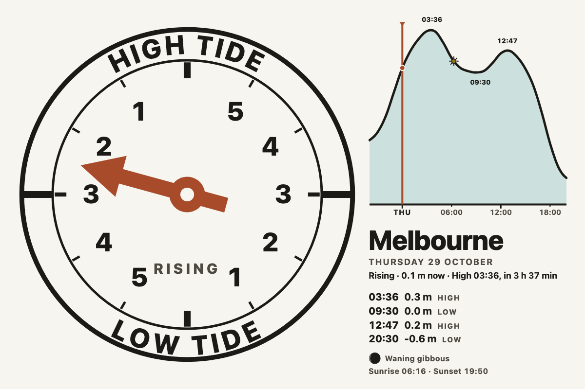
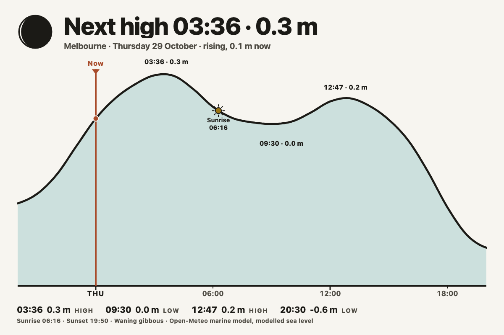
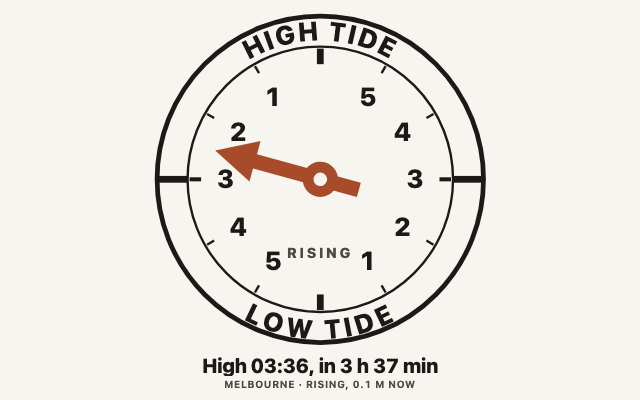
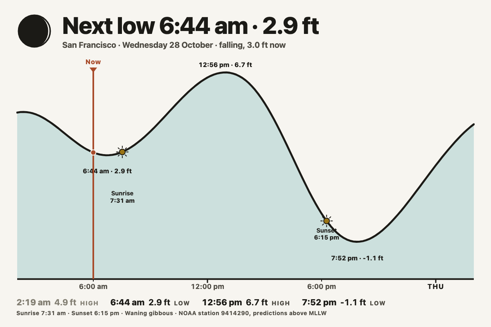
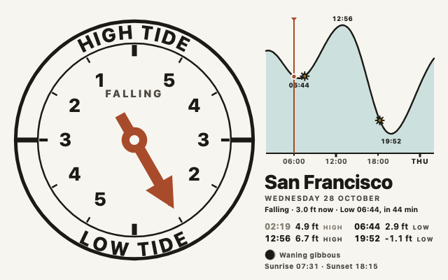
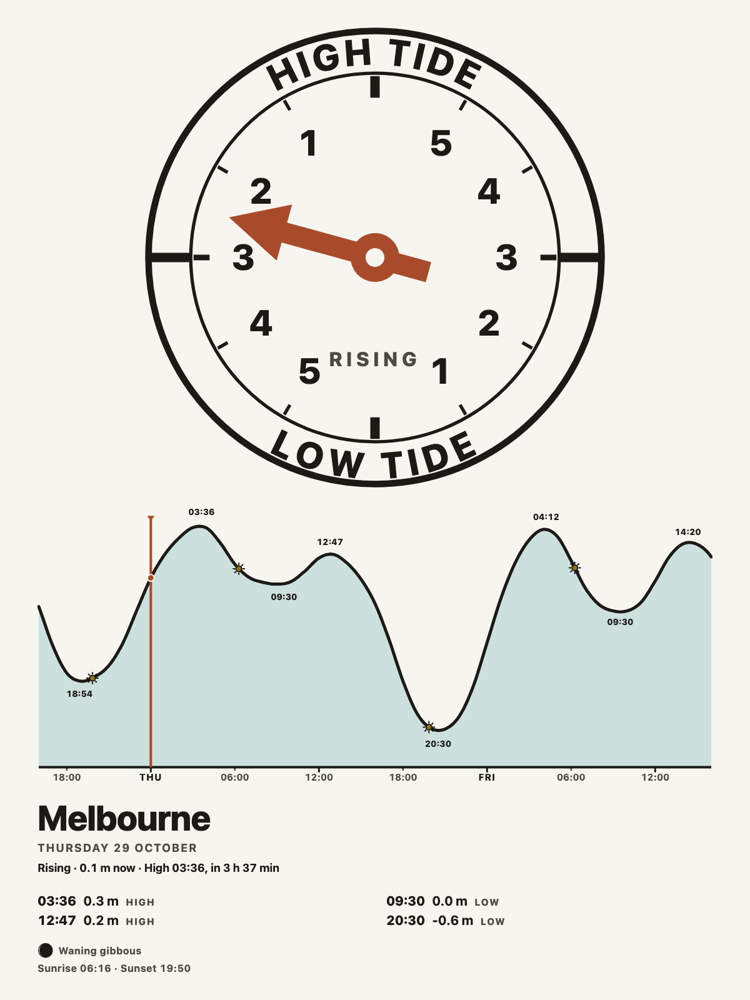
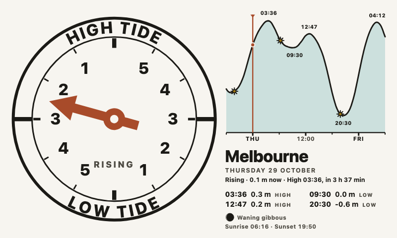
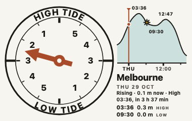
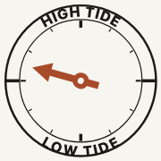
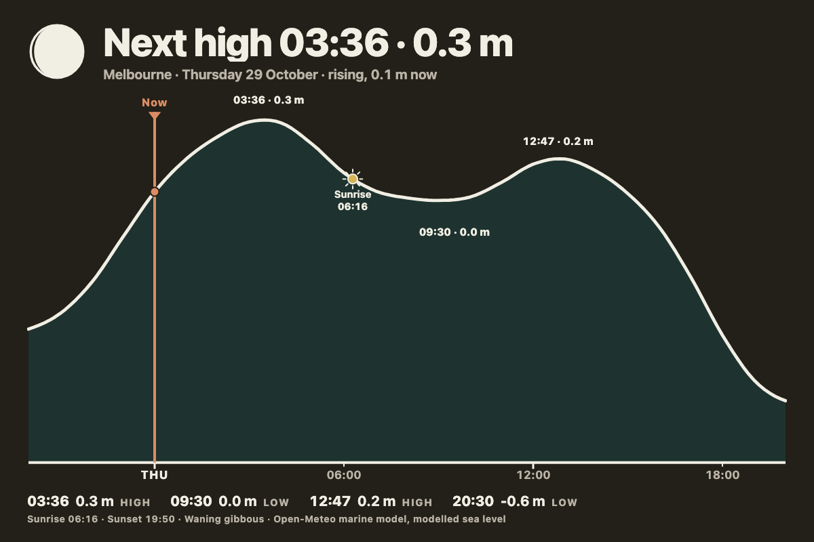

# tide_clock

The tide at a place: a classic tide-clock dial, the tide curve for the next
day or two with now marked on it, today's highs and lows with times and
heights, sunrise and sunset on the curve, and the Moon's phase.

*Dial and curve, the default layout, on a 1200x800 cell. Melbourne from the
Open-Meteo marine model.*

## What it shows

**The dial** is the instrument sailors have hung in their halls for a century:
HIGH TIDE at the top, LOW TIDE at the bottom, and one hand that sweeps round
once per tidal cycle. The numerals count down to the next turn, 5 to 1 down
the right side toward low water and 5 to 1 up the left side back toward high.
The hand's position is worked out from the real highs and lows, not from a
12 h 25 min clockwork: it points straight up at the moment of high water and
straight down at low water, and each half of the cycle is scaled on its own,
so it is right at both ends even on a mixed tide whose ebb and flood run
unequal. The numerals are nominal hours and read as a guide between them.
RISING or FALLING is written on the face as well, because a hand alone is
easy to misread at a glance.

**The curve** runs from a few hours before now to 24, 36 or 48 hours ahead,
filled with water under the line. Now is a vertical rule with a triangle, the
highs and lows are marked with their times (and heights in the Almanac
layout), sunrise and sunset sit on the curve as small suns, and the base is
ticked every six hours with the weekday at midnight.

**The list** is today's highs and lows with times and heights; the ones that
have already passed are muted.

**Sunrise, sunset and the Moon** are computed locally from the place's
coordinates, with no network call: sunrise and sunset from the NOAA solar
equations (good to a minute or so), the Moon's age from a mean synodic month
(good to about half a day, which is finer than a glyph can show). The Moon is
drawn lit on the correct side for the hemisphere.

## Where the data comes from, and its limits

Two sources, chosen with the **Source** option.

**Open-Meteo marine model** (the default, anywhere in the world, no key) gives
hourly sea level height above mean sea level from an ocean model. This is a
*modelled coastal sea level, not a harbour tide table*. On the open coast it
is close; in estuaries, bays and behind headlands it can be an hour or so out
on the timing and short on the range, because the model's grid does not
resolve the local shape of the shore. Port Phillip Bay in the screenshots is
a good example: the model gives Melbourne a small, mixed tide with a double
high, which is roughly right in character, but a harbour table would give
different minutes. The widget finds highs and lows as the local extrema of
the hourly series and refines each one to the minute with a parabola through
the three hours around it, and drops wobbles smaller than a tenth of the
range. The widget reports an error for a place the model has no sea for (an
inland point, a lake), and asks you to move the place to the nearest shore.

**NOAA station** (United States, exact predictions) reads the published
high/low predictions and the half-hourly curve for one tide station from
NOAA's CO-OPS API. Heights are above MLLW in the units you choose, and times
are the station's local time. Find a station id at
<https://tidesandcurrents.noaa.gov/> under Tide Predictions; San Francisco is
9414290. The Place option still matters with this source: it sets sunrise,
sunset and the clock, so put it at or near the station.

Each request is cached for an hour in the widget's data folder, keyed by the
request, and `fresh` renders bypass the cache. When the network is down a
stale copy is used rather than showing nothing, since a tide prediction does
not go off.

## Layouts

**Dial and curve** (default) puts the dial beside the curve, the place and
date, today's list, and a foot with the Moon and the sun times. On a portrait
cell the dial moves to the top.

*Almanac on a 1200x800 cell: the headline is the next turn of the tide, the
Moon's phase sits in the corner, and the curve carries every high and low
with its height, sunrise and sunset with their times, and the now marker.*

*Dial on a 640x400 cell: the clock on its own with the next turn beneath it.
This is also what every cell gets at xs.*

*Almanac from a NOAA station (9414290, San Francisco) in feet with the
12-hour clock, on a 1200x800 cell.*

*Dial and curve from the same NOAA station on a 640x400 cell, the half-panel
size.*

*A 13.3-inch panel in portrait (1200x1600) with the 48-hour curve: two days
of tide, two sunrises, two sunsets.*

*An 800x480 panel with the 36-hour curve, in the editorial style.*

*A 380x240 cell: the dial, a short curve, the next turn and two of today's
events.*

*A 180x180 cell: the dial alone.*

*Almanac on a 1200x800 cell in the dark theme.*

## Options

Place, source, layout, curve length and units are always shown; the station
id appears when the source is NOAA; the clock and title sit under **More
options**.

| Option | Notes |
| --- | --- |
| Place | The shore whose tide to show. Falls back to the app-level location. |
| Source | Open-Meteo marine model (worldwide, modelled, no key) or NOAA station (United States, exact). |
| NOAA station | The seven-digit station id, shown when the source is NOAA. |
| Layout | Dial and curve, Almanac, or Dial. |
| Curve | 24, 36 or 48 hours ahead. The curve starts a few hours before now so the last turn stays in view. |
| Units | Metres or feet. |
| Clock | More options. 24-hour or 12-hour times. |
| Title | More options. Blank uses the place name. |

## Built for e-ink

Everything is inline SVG and type painted from the Spectra tokens: the dial,
its words and the curve's line in the text colour, the hand and the now
marker in accent 1, the water in the soft accent 4. On a black and white
panel the water goes white and the line still carries the curve; the hand
goes black and still reads against the ring. Nothing animates, nothing is
fetched from the browser, and the widget needs only the two API hosts it
declares.

## Licence

AGPL-3.0. See [LICENSE](LICENSE). Sea level from the
[Open-Meteo Marine API](https://open-meteo.com/en/docs/marine-weather-api)
(CC BY 4.0, data from Copernicus Marine and partner models); tide
predictions from
[NOAA CO-OPS](https://tidesandcurrents.noaa.gov/) (public domain). Sunrise
and sunset follow the NOAA solar calculator's equations.
